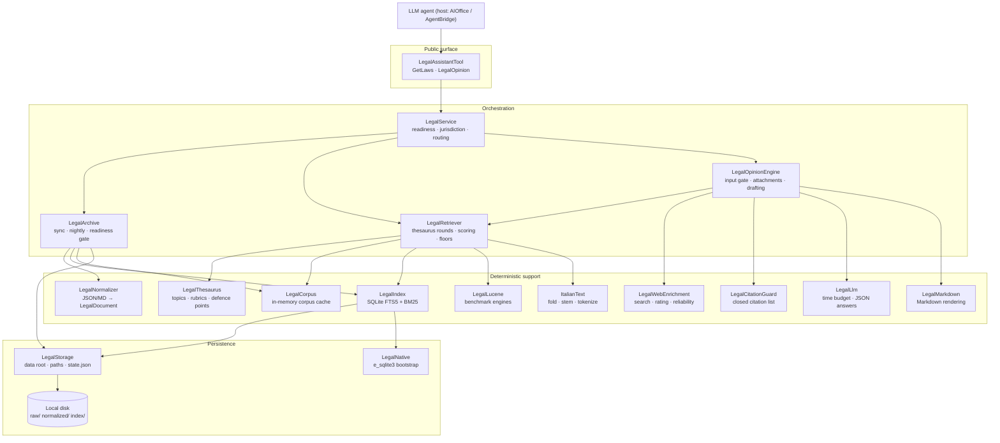
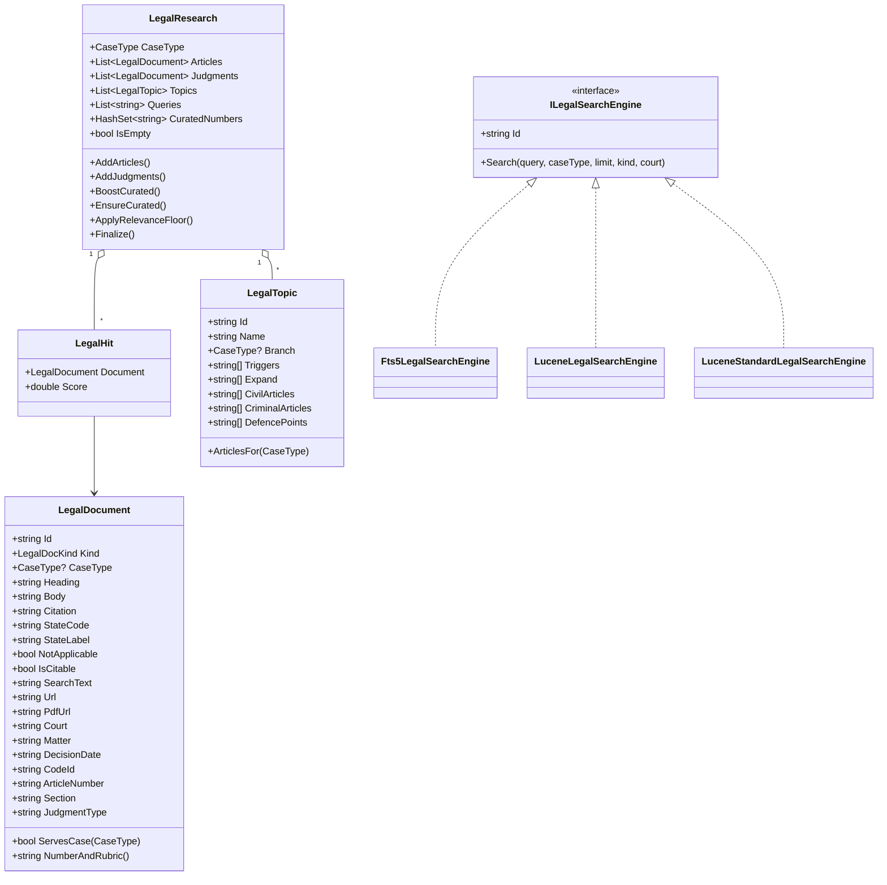
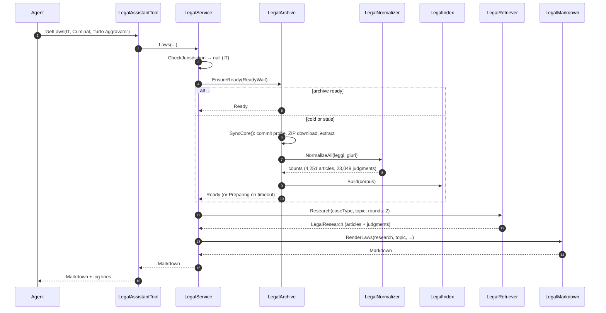
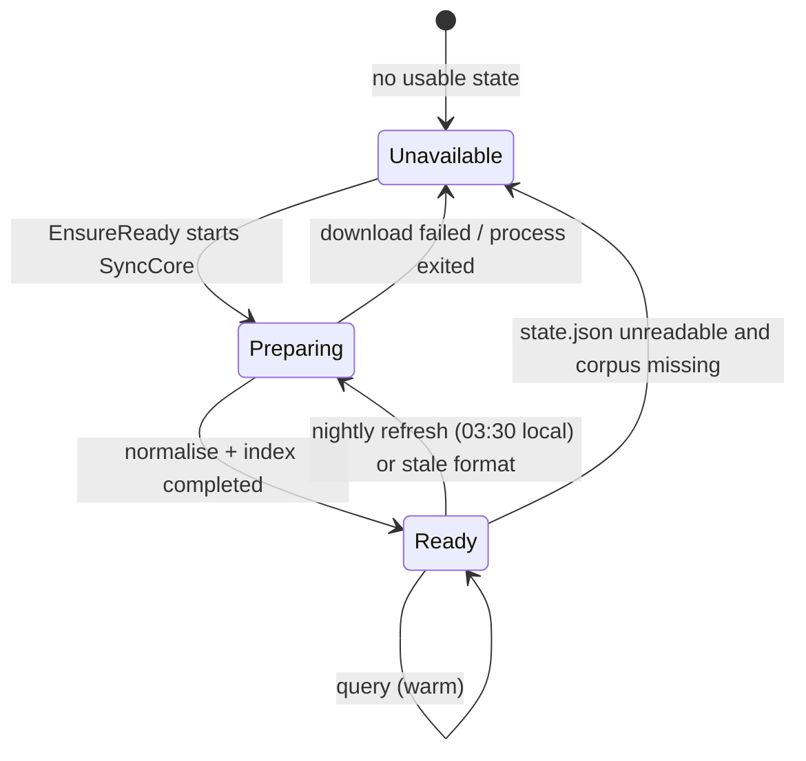

# Architecture

## 1. Layers

The tool is a plugin assembly with no static dependency on the host: `AIOrchestrator` supplies
`BaseAgentTool`, `IFileTool`, `Log`, `LLMUtility`, `FileManager` and `SandboxPath`. Everything legal
lives in the `AIOrchestrator.API.Legal` namespace and is `internal`, so the only surface the agent
sees is the two public methods.



## 2. Component reference

| Type | File | Responsibility | Key members |
|---|---|---|---|
| `LegalAssistantTool` | `LegalAssistantTool.cs` | Agent surface, logging, exception → `Error:` text. | `GetLaws`, `LegalOpinion` |
| `LegalService` | `Legal/LegalService.cs` | Jurisdiction check, readiness wait, routing to retrieval or opinion. | `Prepare`, `CheckJurisdiction`, `Laws`, `Opinion`, `ReadyWait` |
| `LegalArchive` | `Legal/LegalArchive.cs` | Commit probe, ZIP download/extract, rebuild decision, nightly loop, readiness gate. | `EnsureReady`, `StartSync`, `SyncNow`, `NextNightlyRun`, `FormatVersion`, `NightlyHour` |
| `LegalStorage` | `Legal/LegalStorage.cs` | Data-root resolution and every path; `state.json` read/write. | `Root`, `SqlitePath`, `ArticlesJsonl`, `ReadState`, `WriteState` |
| `LegalNormalizer` | `Legal/LegalNormalizer.cs` | Maps both repositories to `LegalDocument` and writes JSONL. | `NormalizeAll`, `NormalizeArticles`, `NormalizeJudgments` |
| `LegalCorpus` | `Legal/LegalCorpus.cs` | Lazy, cached in-memory corpus loaded from JSONL. | `Load`, `ById`, `Article`, `Invalidate` |
| `LegalIndex` | `Legal/LegalIndex.cs` | FTS5 table creation, insert, BM25 search, MATCH expression. | `Build`, `Search`, `Count`, `BuildMatchExpression` |
| `LegalLucene` | `Legal/LegalLucene.cs` | Optional Lucene indexes used by the benchmark. | `Build`, `Search`, `CreateAnalyzer`, `DefaultEngine` |
| `LegalRetriever` | `Legal/LegalRetriever.cs` | Research orchestration: topics, rounds, scoring, floors, diversification; engine registry. | `Research`, `CuratedArticles`, `JudgmentScore`, `ArticleAffinity`, `LegalSearchEngines.Resolve` |
| `LegalResearch` | `Legal/LegalRetriever.cs` | Accumulator for one research: hits with weights, curated numbers, queries. | `AddArticles`, `AddJudgments`, `BoostCurated`, `EnsureCurated`, `ApplyRelevanceFloor`, `Finalize` |
| `LegalThesaurus` | `Legal/LegalThesaurus.cs` | Curated knowledge base: 23 topics with triggers, curated articles per branch, expansion terms, defence points. | `Topics`, `Match`, `ExpansionTerms`, `DefencePoints` |
| `LegalOpinionEngine` | `Legal/LegalOpinionEngine.cs` | Input gate, attachment budget, research, web enrichment, drafting, report assembly. | `CheckInput`, `Opinion` |
| `LegalAttachments` | `Legal/LegalAttachments.cs` | Reads attachments through the sandbox (PDF, DOCX, HTML, text). | `Read`, `HtmlToText` |
| `LegalWebEnrichment` | `Legal/LegalWebEnrichment.cs` | Web search + per-page usefulness rating + source reliability; silently skipped offline. | `Enrich`, `ReliabilityOf` |
| `LegalLlm` | `Legal/LegalLlm.cs` | Single entry point for model calls: global time budget, JSON parsing, summarisation. | `Ask`, `AskJson`, `Summarize`, `AttachmentBudget`, `Reset` |
| `LegalCitationGuard` | `Legal/LegalCitationGuard.cs` | Sentence-level audit against the closed citation list. | `Audit`, `JudgmentKey` |
| `LegalMarkdown` | `Legal/LegalMarkdown.cs` | Renders `GetLaws`, the 12-section opinion and the insufficient-input document. | `RenderLaws`, `RenderOpinion`, `RenderInsufficientInput` |
| `ItalianText` | `Legal/ItalianText.cs` | Fold, stem, tokenize, coverage, sentence split, clipping. | `Normalize`, `Stem`, `Tokenize`, `Coverage`, `Sentences` |
| `LegalNative` | `Legal/LegalNative.cs` | Loads the bundled `e_sqlite3` from the plugin folder by absolute path. | `EnsureSqlite` |
| `LegalModel` | `Legal/LegalModel.cs` | `LegalJurisdiction`, `CaseType`, `LegalDocKind`, `SourceReliability`, `LegalDocument`. | — |

## 3. Object model



## 4. Runtime lifecycle

The first call of a fresh installation performs the whole cold install inline, then answers. Every
later call is served from the local index.



Measured cold install on a normal connection: **313 s** (62 s download, 238 s normalisation, 13 s FTS5
build). Warm calls take 0.4–2.6 s. `LEGALASSISTANTTOOL_READY_SECONDS` (default 360, clamp 30–900)
bounds how long a call waits; past it the call returns a "still preparing" text while the background
sync continues.



`ArchiveStatus` values map to the three texts produced by `LegalService.Prepare`: `Ready` → no error,
`Preparing` → "still being prepared, retry in a couple of minutes", `Unavailable` → "check the
internet connection and retry".

## 5. Storage layout

The data root is `%LOCALAPPDATA%\Graphene\LegalAssistantTool` on Windows and
`~/.local/share/Graphene/LegalAssistantTool` elsewhere; `LEGALASSISTANTTOOL_DATA` overrides it (the
test harness points it at `<project>\.data`). Nothing is written next to the executable or inside the
plugin folder — the plugin folder is replaced on update.

```text
<root>/
├── state.json               # commits, counts, format version, index metadata
├── raw/
│   ├── leggi-italiane/      # extracted ZIP (~8 MB)
│   └── giurisprudenza-db/   # extracted ZIP (~54 MB)
├── normalized/
│   ├── articles.jsonl       # one LegalDocument per line
│   └── judgments.jsonl
└── index/
    ├── legal.db             # SQLite + FTS5 (the index the tool searches)
    └── lucene-<engine>/     # only when LEGALASSISTANTTOOL_LUCENE=1 (benchmark)
```

Total footprint ≈466 MB. There is **no database server and no configuration file**: `legal.db` is a
single embedded SQLite file created on demand with `SqliteOpenMode.ReadWriteCreate`, and the native
`e_sqlite3` travels inside the plugin package.

## 6. Concurrency and caching

| Mechanism | Where | Purpose |
|---|---|---|
| `SemaphoreSlim Gate` | `LegalArchive` | Serialises syncs: concurrent tool calls never download twice. |
| `_sync` / `_nightly` tasks | `LegalArchive` | One in-flight sync task and one nightly loop per process. |
| `_progress` (volatile string) | `LegalArchive` | Human-readable progress shown in the "still preparing" text. |
| `_indexLoaded` | `LegalArchive` | Loads the corpus into memory once per process. |
| `LegalCorpus` cache | `LegalCorpus` | `Load(forceReload)` + `Invalidate()` after a rebuild. |
| `LegalLlm.Reset()` + `RemainingSeconds` | `LegalLlm` | Per-call model time budget; every call re-checks it. |
| Pooled read-only connections | `LegalIndex` | Each search opens a `SqliteOpenMode.ReadOnly` pooled connection; writers only exist during a rebuild. |

## 7. Error philosophy

* The two public methods never throw: every exception becomes `"Error: …"` with the cause and a next
  action (see `LegalAssistantTool`).
* Optional stages degrade silently: web enrichment (no connection, blocked host, unreadable page) and
  model drafting (no provider, budget exhausted, invalid JSON) log a line and the deterministic path
  continues.
* Required stages fail loudly but politely: no archive after the wait → "still preparing"; empty facts
  → insufficient-input document; non-`IT` jurisdiction → deterministic error.

## 8. Plugin loading

`ToolPluginHost` (`AIOrchestrator/ToolPluginHost.cs`) resolves only **managed** assemblies from
`Tools\<Plugin>\` through `AssemblyLoadContext.Default.Resolving`, and host assemblies win. That is why
`LegalNative.EnsureSqlite()` loads the bundled native `e_sqlite3.dll` by absolute path from the plugin
folder instead of relying on the default native probe, and why the plugin folder ships its own
`Microsoft.Data.Sqlite`, `SQLitePCLRaw.*`, `Lucene.Net*`, `J2N`, `UglyToad.PdfPig*` — but never
`AIOrchestrator.dll`.