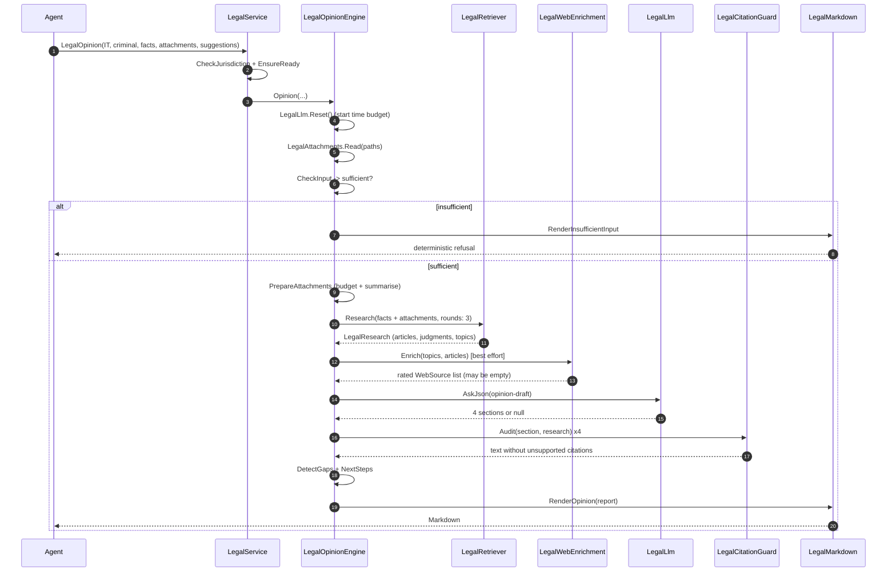
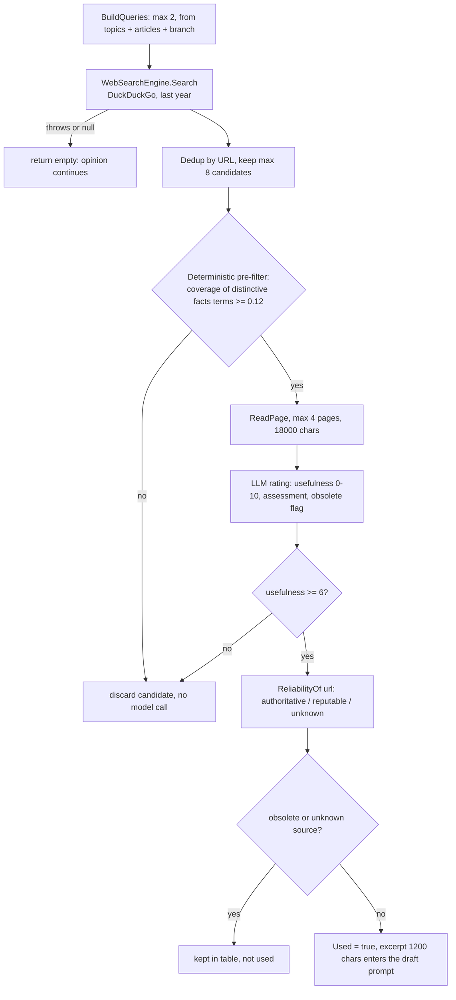

# The opinion engine

`LegalOpinion` is the method that produces a *parere legale*. This document explains how it is
built, why every step is ordered the way it is, and where to intervene.

- [1. The contract](#1-the-contract)
- [2. Call flow](#2-call-flow)
- [3. Input gate](#3-input-gate)
- [4. Attachments](#4-attachments)
- [5. Research](#5-research)
- [6. Web enrichment](#6-web-enrichment)
- [7. Drafting](#7-drafting)
- [8. Citation guard](#8-citation-guard)
- [9. Report assembly](#9-report-assembly)
- [10. Deterministic fallback](#10-deterministic-fallback)
- [11. Degradation matrix](#11-degradation-matrix)
- [12. Tuning](#12-tuning)

---

## 1. The contract

An opinion must satisfy four properties, in this order of priority:

1. **No invented law.** Every article and every judgment in the output must come from the archive,
   with its text and a verifiable link. This is enforced three times: the model never sees the
   corpus, it receives a closed list of citations, and its prose is audited sentence by sentence.
2. **Deterministic behaviour.** With no model available the opinion is still produced, written from
   the retrieved texts. A model improves the prose; it is never the source of the answer.
3. **Refusal over guessing.** If the input cannot support an opinion, the tool says so explicitly
   instead of producing a plausible-sounding document.
4. **Bounded cost.** A whole opinion may spend at most `LegalLlm.BudgetSeconds` (default 240 s) in
   model calls, and never blocks a conversation for longer.

The engine lives in `Legal/LegalOpinionEngine.cs`. It is a pure orchestrator: retrieval is in
`LegalRetriever`, the citation audit in `LegalCitationGuard`, the internet in
`LegalWebEnrichment`, and the rendering in `LegalMarkdown`.

## 2. Call flow



The order is not negotiable: research must finish before the web pass (the web queries are built
from the topics and the selected articles), and the citation audit must run after the draft and
before rendering.

## 3. Input gate

`CheckInput(caseType, facts, attachments)` runs **before** any network or model call and without
any model. It is the mechanism that produces the deterministic "insufficient data" output the
requirements ask for.

| Test | Threshold / pattern | Effect |
|---|---|---|
| Content words in the facts | `MinContentTerms = 12` | Below: hard refusal, the opinion is not attempted |
| Role of the client | `attore`, `convenuto`, `imputato`, `indagato`, `persona offesa`, `locatore`, `conduttore`, `datore di lavoro`, `minore`, `erede`, ... | Listed in §9 "Dati mancanti" |
| Date or period | `dd/mm/yyyy`, `yyyy`, any 19xx/20xx | Listed as missing |
| Procedural phase | `indagini`, `udienza`, `giudizio`, `appello`, `citazione`, `ricorso`, `atto di`, `mediazione`, `pignoramento`, ... | Listed as missing |
| Amount at stake | `1.500 €`, `euro 20000` | Listed as missing (gaps) |
| Mental element (criminal) | `dolo`, `colpa`, `negligenza`, `imprudenza`, `imperizia`, `mala fede` | Listed as missing (gaps) |
| Attachments | at least one with readable text | Suppresses most of the above, because the document usually contains the missing data |

Two levels of severity matter:

* **Hard stop** - fewer than 12 content words. There is nothing to qualify; the output is
  `# Dati insufficienti per il parere legale` with the reason, the missing items and concrete
  instructions on how to reformulate.
* **Soft gaps** - everything else. The opinion is produced, and the gaps are listed in §9 so the
  lawyer knows what to ask the client. This is intentional: a real consultation starts from
  incomplete information, and refusing every incomplete request would make the tool useless.

A second hard stop exists after research: if the archive returns nothing relevant (`IsEmpty`), the
output is again the deterministic refusal, explaining that the topic is not covered and how to
rephrase. This is what prevents a confident opinion about a subject the archive does not contain.

## 4. Attachments

`LegalAttachments.Read` turns every path into plain text, in this order:

| Format | How | Note shown to the user |
|---|---|---|
| `.txt`, `.md`, `.markdown`, `.csv`, `.tsv`, `.json`, `.xml`, `.yml`, `.yaml`, `.log`, `.rtf` | `File.ReadAllText` UTF-8 | "testo letto integralmente" |
| `.html`, `.htm`, `.xhtml` | tag stripping (`HtmlToText`) | "HTML convertito in testo" |
| `.pdf` | PdfPig page-by-page text extraction | "PDF estratto" |
| `.docx` | `word/document.xml` paragraph text read straight from the zip | "DOCX estratto" |
| anything else, missing, unreadable | not read | the note explains why |

A single bad attachment never blocks the opinion: it becomes a bullet in §11 "Allegati esaminati"
with the reason. Everything stays inside the workspace sandbox; there is no upload and no network
access for attachments.

### 4.1 Context budget

```csharp
budget = max(4000, ContextChars / 3 / attachmentCount)   // LegalLlm.AttachmentBudget
ContextChars = (ContextWindow ?? 32000) * 3              // 3 chars per Italian token
```

Each attachment larger than its share is reduced:

1. **Model summary** - `LegalLlm.Summarize(text, budget, label)` keeps the salient data (parties,
   dates, amounts, claims) and the attachment note becomes "riassunto per rientrare nella finestra
   di contesto".
2. **Deterministic clip** - if no model is available, `ItalianText.Clip` keeps head and tail and the
   note becomes "estratto ridotto (riassunto automatico non disponibile)".

The attachments are then joined as `ALLEGATO <name>:` blocks and clipped to 4,000 characters for
the *retrieval* query, so a 200-page contract cannot flood the term statistics. The full (already
budgeted) text is what goes into the drafting prompt.

## 5. Research

`LegalRetriever.Research(caseType, facts + clipped attachments, [suggestions], CitableArticles = 10,
CitableJudgments = 6, rounds: 3)`.

Everything about ranking, the relevance floor, the court mix and the benchmark is in
[RETRIEVAL.md](RETRIEVAL.md). Two points specific to the opinion:

* The **suggestions** are appended to the facts for topic detection and query building, so a lead
  like "le chiavi erano nel cruscotto" changes the retrieved norms and the defence points. They are
  also rendered as their own section (§3) so the reader sees which leads were considered.
* The opinion asks for **more** than `GetLaws` (10 articles / 6 judgments, 3 rounds instead of 2):
  a document needs the full norm set and enough precedent to argue, while a quick lookup needs the
  two or three norms that answer the question.

## 6. Web enrichment

`LegalWebEnrichment.Enrich` is optional context for the *strategy*, never for the law. It runs
after retrieval because the queries are built from the topics and the selected articles.



| Constant | Value | Meaning |
|---|---|---|
| `MaxQueries` | 2 | How many web searches per opinion |
| `MaxCandidates` | 8 | Results kept after de-duplication |
| `MaxPagesToRead` | 4 | Pages actually downloaded and converted to text |
| `MaxRatings` | 2 | Model calls spent rating pages |
| `MinCoverage` | 0.12 | Share of distinctive fact terms a preview must contain to be read at all |
| `MinUsefulness` | 6 | Rating below which the page is discarded |
| `MaxPageChars` | 18000 | Truncation of the page before rating |
| `ExcerptChars` | 1200 | Text kept for the draft prompt |

**Reliability** comes from two hard-coded domain lists, not from the model:

* authoritative: `normattiva.it`, `gazzettaufficiale.it`, `cortecostituzionale.it`,
  `cortedicassazione.it`, `cassazione.it`, `giustizia.it`, `giurisprudenzapenale.com`,
  `unionedellecamerapenali.it`, `questionegiustizia.it`, `dirittopenalecontemporaneo.it`;
* reputable but not authoritative: `altalex.com`, `ilsole24ore.com`, `diritto.it`,
  `laleggepertutti.it`, `brocardi.it`, `camera.it`, `senato.it`, `consiglionazionaleforense.it`,
  `filodiritto.com`, `iusinitinere.it`, `sistemapenale.it`, `penaledp.it`, `giurcost.org`, ...

**Obsolescence** is detected on the page text (mentions of abrogation/repeal). A page that looks
superseded stays in the §8 table marked "superata" but is never used as context.

Everything here is best effort. If the machine is offline, the search throws, the page does not
load, the model refuses or the budget is exhausted, the method returns what it has - possibly
nothing - and logs `Web search unavailable for '...': ... Enrichment skipped.` The opinion is never
degraded by the absence of the internet, and no error is surfaced to the agent.

## 7. Drafting

Only four narrative sections are drafted by the model: `Sintesi`, `Qualificazione`, `Strategia`,
`Rischi`. Everything else in the report is assembled deterministically from the retrieved data
(the law, the case law, the gaps, the next steps, the sources).

`BuildDraftPrompt` gives the model:

* the facts and the attachments;
* the **closed list** of retrieved articles, each with number, rubric and text;
* the **closed list** of retrieved judgments, each with citation and outcome;
* the rated web excerpts, clearly marked as non-authoritative;
* the suggestions, marked as leads to evaluate;
* the instruction to cite only from those lists and to say so explicitly when something is missing.

The response is parsed as JSON (`AskJson<OpinionSections>`, 1400 tokens). The call is given
`min(150, RemainingSeconds - 30)` seconds, so the audit and the deterministic sections still have
time to run inside the budget.

A section is accepted only if, after the citation audit, at least 80 characters remain. The report
is considered model-drafted when at least two of the four sections survive; otherwise the whole
report falls back to the deterministic prose, which is logged as
`Draft: model produced N/4 usable sections, M sentences removed.`

## 8. Citation guard

This is the anti-hallucination mechanism the requirements call for. It is deliberately simple and
brutal: if a sentence cites something that retrieval did not return, the sentence is deleted.

| Detected | Regex | Verified against |
|---|---|---|
| `art. 624`, `art.624`, `articolo 624`, `artt. 624 e 625` | `\b(?:art(?:icolo|t)?\.?)\s*(\d{1,4})(?:\s*(?:e|,|-|/)\s*(\d{1,4}))?` | article numbers in `LegalResearch.CuratedNumbers` and in the retrieved articles |
| `n. 12345/2023`, `n. 12345/23` | `\bn\.\s*(\d{1,6})\s*/\s*(\d{2,4})\b` | `JudgmentKey` of the retrieved judgments (number + normalised 4-digit year) |
| `Cass.`, `Cassazione`, `Corte cost.`, `Corte costituzionale` | court name | a retrieved judgment of that court must exist for the sentence to survive |

Rules:

* The audit works sentence by sentence (`SplitParagraphs` + sentence split), so one bad citation
  costs one sentence, not the whole section.
* Numbers written as words, generic references ("la norma", "la sentenza citata") and any statement
  without a citation pass untouched.
* Removed sentences are counted, and if any were removed the report shows §12 "Controllo delle
  citazioni" stating how many passages were dropped and why.
* `LegalCitationGuard.JudgmentKey` normalises `2023` and `23` to the same key, so a model that
  abbreviates the year is not penalised.

Because the archive itself is the only source, a citation that survives the audit is guaranteed to
exist in the retrieved set, and the rendered section prints its exact text and link. The harness
mode `verify` re-checks the rendered output of every test case and reports `0 invented citations`.

## 9. Report assembly

`LegalMarkdown.RenderOpinion` writes the document. Numbering is dynamic: section 3 only appears
when the caller supplied suggestions, and section 8 only when web enrichment ran.

| § | Title | Source | Always present |
|---|---|---|---|
| - | Title + metadata block (jurisdiction, branch, date, archive, sources, drafting mode) | deterministic | yes |
| 1 | Sintesi del parere | model or deterministic | yes |
| 2 | Qualificazione giuridica dei fatti | model or deterministic | yes |
| 3 | Piste indicate dal richiedente | suggestions | if any |
| 4 | Norme applicabili (testo vigente) | archive | yes |
| 5 | Giurisprudenza di riferimento | archive | yes |
| 6 | Strategia difensiva | model or deterministic | yes |
| 7 | Punti di debolezza e rischi | model or deterministic | yes |
| 8 | Approfondimenti esterni valutati | web enrichment | if any page was read |
| 9 | Dati mancanti | `CheckInput` + `DetectGaps` | if any |
| 10 | Azioni consigliate | thesaurus defence points + procedural reminders | yes |
| 11 | Allegati esaminati | attachments | if any |
| 12 | Controllo delle citazioni | citation guard | if anything was removed |
| - | Fonti e verificabilità | every article/judgment link | yes |

Every article block contains: exact citation (`Art. 624 c.p.`), rubric, state label (in vigore /
ABROGATO / ...), the text, and the source link. Every judgment block contains: full citation, court,
date, outcome, and the link to the official scheda or PDF. That is what makes the output verifiable
by a third party.

## 10. Deterministic fallback

`DeterministicSections` writes the four narrative sections from data alone when no usable model
output exists:

* **Sintesi** - the branch, the matched topics, the number of norms and precedents found, and the
  single most relevant article and judgment with their citations.
* **Qualificazione** - the rubric of the first articles and the outcome of the first judgment,
  phrased as the legal question the case raises.
* **Strategia** - the defence points of the matched topics (what must be proven, what can be
  attacked), each anchored to an article or a judgment of the archive.
* **Rischi** - the missing information and the elements the other side will use.

This is why the tool is useful even with no LLM configured, and why the tests can assert on the
output deterministically.

## 11. Degradation matrix

| Missing | Effect | Visible in the output |
|---|---|---|
| Internet | Web enrichment skipped, everything else works | §8 absent |
| LLM provider | Deterministic sections used | "Modalità di redazione: redazione deterministica..." |
| LLM slower than the budget | Remaining calls skipped, partial sections kept | "prosa assistita dal modello" only if 2+ sections survived |
| Attachments unreadable | Note per file | §11 explains each one |
| Archive still preparing | No opinion; the caller gets the "preparing" block | `Archive being prepared` |
| Topic not covered | Deterministic refusal | `# Dati insufficienti per il parere legale` |
| Fewer than 12 content words | Deterministic refusal before any work | same |

## 12. Tuning

| I want to... | Where |
|---|---|
| Change what counts as sufficient input | `LegalOpinionEngine.CheckInput`, `MinContentTerms` |
| Change how many sources the opinion may cite | `CitableArticles`, `CitableJudgments` |
| Change the attachment budget or the summarisation | `LegalLlm.AttachmentBudget`, `PrepareAttachments` |
| Change the drafting prompt | `LegalOpinionEngine.BuildDraftPrompt` |
| Change what the citation guard accepts | `LegalCitationGuard` regexes and `Audit` |
| Change the web policy | `LegalWebEnrichment` constants and the two domain lists |
| Change the report structure | `LegalMarkdown.RenderOpinion` (and `AppendArticles` / `AppendJudgments`) |
| Change the deterministic prose | `LegalOpinionEngine.DeterministicSections` |
| Change the time budget | `LEGALASSISTANTTOOL_LLM_BUDGET_SECONDS` (default 240) |

After a change, run the harness in this order: `opinion` (5 cases, including the insufficient-input
and no-attachment ones), `verify` (citation audit of every rendered answer), then the benchmark if
retrieval was touched. See [DEVELOPER-GUIDE.md](DEVELOPER-GUIDE.md).