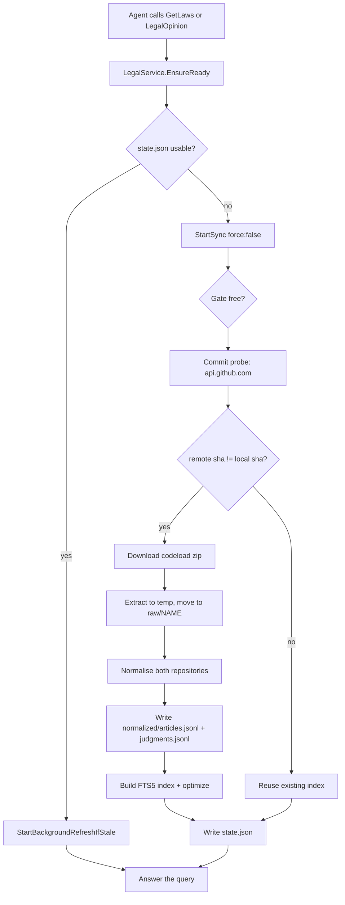
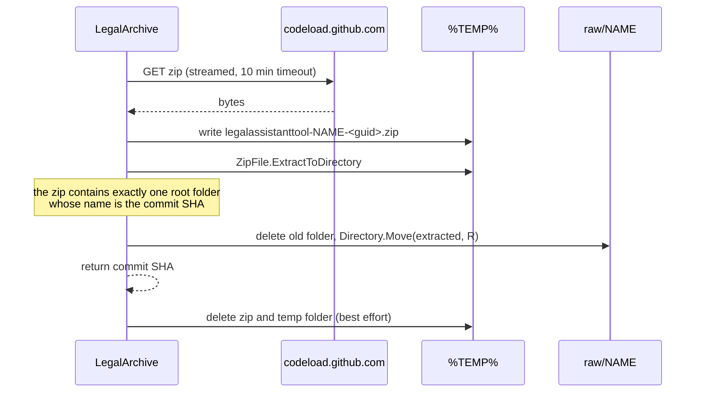
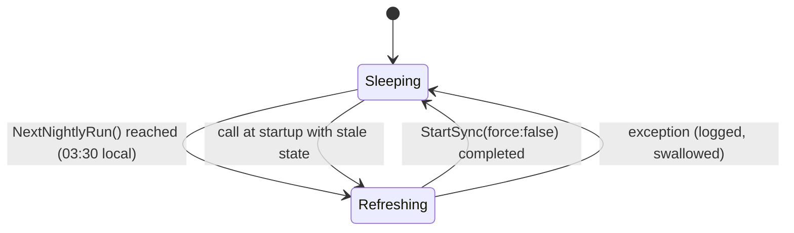

# Pipeline: sync, normalisation and index

This document describes everything that happens **before** a query is answered: how the two
source repositories reach the disk, how their files become a uniform corpus, and how that corpus
becomes the search index. Read it when you need to change a source, fix a parsing rule, or
understand why a rebuild happened.

- [1. Design constraints](#1-design-constraints)
- [2. End-to-end flow](#2-end-to-end-flow)
- [3. Readiness gate](#3-readiness-gate)
- [4. Change detection](#4-change-detection)
- [5. Download and extraction](#5-download-and-extraction)
- [6. Normalisation](#6-normalisation)
- [7. Index build](#7-index-build)
- [8. Scheduling](#8-scheduling)
- [9. The state file](#9-the-state-file)
- [10. Failure behaviour](#10-failure-behaviour)
- [11. Operating the pipeline](#11-operating-the-pipeline)
- [12. Changing the pipeline](#12-changing-the-pipeline)

---

## 1. Design constraints

| Constraint | Consequence in the code |
|---|---|
| No database server, no external service | One embedded SQLite file, `index/legal.db`, opened with `e_sqlite3` shipped in the package. |
| No configuration file | Every path is derived from `LegalStorage.Root`; the only knobs are environment variables. |
| Must work offline | Every network call is best effort and caught; a failure leaves the last good archive in place. |
| Nightly, in the user's local time | `LegalArchive.NightlyLoop` waits on `DateTime.Now`, not UTC. |
| Never answer from a stale or half-built index | The corpus is only usable when `state.json` says the index matches the current `FormatVersion`. |

The whole pipeline lives in three files:

| File | Responsibility |
|---|---|
| `Legal/LegalArchive.cs` | Orchestration: readiness, change probe, download, scheduling, state. |
| `Legal/LegalNormalizer.cs` | Parsing of the two repositories into `LegalDocument` records. |
| `Legal/LegalIndex.cs` | FTS5 schema, bulk insert, `optimize`, BM25 query. |

## 2. End-to-end flow



The left branch is the steady state: a warm archive answers in under three seconds and the
refresh, when due, runs on a background task that nobody waits for.

## 3. Readiness gate

`LegalArchive.EnsureReady(TimeSpan maxWait)` is the single entry point. Its contract:

1. It starts the nightly loop if it is not running (idempotent, guarded by `NightlyLock`).
2. If `IsUsable(state)` is true it returns `Ready` **immediately** and, if the last check is
   older than 12 hours, fires a background refresh.
3. Otherwise it joins or starts a synchronisation and waits at most `maxWait`.

`IsUsable` requires all of the following, so a partially written archive is never queried:

```csharp
state.IndexBuiltUtc != null
&& !state.NeedsRebuild(FormatVersion)
&& state.ArticleCount > 0
&& File.Exists(LegalStorage.SqlitePath)
```

The wait budget is `LegalService.ReadyWait`, default **360 s**, overridable with
`LEGALASSISTANTTOOL_READY_SECONDS` (clamped to 30-900 s). A measured cold install on a clean
machine takes about **313 s** (62 s download, 238 s normalisation, 13 s index build), so the
default covers the first call of a fresh installation on a normal connection.

When the wait expires the caller receives `Preparing` with a human message
("the local legal archive is being prepared (step: ...); call the tool again in a few minutes")
and the synchronisation keeps running in the background. This is the only case in which a tool
call does not answer with legal content, and it is a *state*, not an error.

| Status | Meaning | What the tool renders |
|---|---|---|
| `Ready` | Corpus and index on disk and queryable. | The normal Markdown answer. |
| `Preparing` | A synchronisation is running right now. | "Archive being prepared" block with the current step. |
| `Unavailable` | No usable archive and the sync failed. | "Archive unavailable" block with the reason. |

## 4. Change detection

Before downloading anything the pipeline asks GitHub for the tip commit of each branch:

| Repository | Probe | Zip |
|---|---|---|
| `Andrea-Bruno/leggi-italiane` | `api.github.com/repos/Andrea-Bruno/leggi-italiane/commits/master` | `codeload.github.com/.../zip/refs/heads/master` |
| `Synthos-Logic/giurisprudenza-db` | `api.github.com/repos/Synthos-Logic/giurisprudenza-db/commits/main` | `codeload.github.com/.../zip/refs/heads/main` |

`IsRemoteChanged` compares the `sha` field with `state.LeggiCommit` / `state.GiuriCommit`.

Three rules matter:

* **First run always downloads.** A `null` local SHA means "unknown", so `IsRemoteChanged`
  returns `true` without asking GitHub.
* **A failed probe means "unchanged".** Timeout, DNS failure, rate limit, HTTP 403: the method
  logs the outcome and returns `false`. The archive stays as it is instead of being thrown away.
* **`force` skips the probe.** `SyncNow(force: true)` (used by the harness and the benchmark) and
  `LEGALASSISTANTTOOL_LUCENE=1` rebuilds always re-download.

## 5. Download and extraction

`DownloadAndExtract` is deliberately dumb and idempotent:



* The commit SHA is recovered from the extracted root folder name - that is how GitHub names the
  folder inside an archive - so no extra API call is needed after the download.
* The move is a directory rename on the same volume; the previous corpus is deleted first, so a
  failed extraction can never leave a mixed tree. If the download itself fails, nothing is
  deleted and the previous `raw/` tree stays valid.
* User-Agent is `Graphene-LegalAssistantTool/1.0` and `Accept: application/vnd.github+json`.

## 6. Normalisation

`LegalNormalizer.NormalizeAll(leggiRoot, giuriRoot)` returns `NormalizeCounts(Articles, Judgments)`
and writes two JSONL files under `normalized/`. Both sources converge on the same
`LegalDocument` shape, which is what makes a single index possible.

### 6.1 leggi-italiane - articles

Source layout: `raw/leggi/<commit>/data/<code>/codice/*.json`, where `<code>` is `civile` or
`penale`. A missing `data/` folder is logged and the branch is skipped.

| Source field | `LegalDocument` | Notes |
|---|---|---|
| `data/<code>` folder name | `CodeId` | `civile` / `penale`. |
| `articolo.numero` | `ArticleNumber` | Keeps suffixes: `624`, `3-bis`, `648-bis`. |
| `articolo.rubrica` | `Matter` | Human title of the article. |
| `articolo.rubrica` + number | `Heading` | `Art. 624 c.p. — Furto`, or the citation alone when there is no rubric. |
| `testo.vigente` | `Body` | Falls back to `testo.con_marcatori`; cleaned (whitespace collapsed, punctuation kept). |
| `stato.codice` | `StateCode` | `vigente`, `abrogato`, `parzialmente_inapplicabile`, `dichiarato_incostituzionale`; empty defaults to `vigente`. |
| `stato.motivazione` | `StateNote` | Human explanation when the archive provides one. |
| `stato.inapplicabile` | `NotApplicable` | Boolean; makes the article non-citable. |
| `articolo.sezione` | `Section` and `Extra` | Section of the code, also searchable through `Extra`. |
| `articolo.url` | `Url` | The archive's own Normattiva link; never rebuilt by the tool. |
| `codice.denominazione` | - | Abbreviation fallback for codes other than `civile` / `penale`. |
| - | `Id` | `art:<codeId>:<number>`, stable across rebuilds. |
| - | `Citation` | `Art. 624 c.p.` / `Art. 2043 c.c.`, from the code abbreviation. |
| - | `CaseType` | `penale` -> `Criminal`, `civile` -> `Civil`, otherwise `null`. |
| - | `SourceRepo` | `leggi-italiane`. |

An article whose JSON cannot be parsed, or that has no `articolo.numero`, is skipped and logged;
it never aborts the run.

### 6.2 giurisprudenza-db - judgments

Source layout: Markdown schede with YAML front matter (`---` ... `---`) followed by `#` title and
`##` sections, grouped in folders by court and branch. This is the third-party repository, so the
parser is defensive and the file set is filtered.

| Source field | `LegalDocument` | Notes |
|---|---|---|
| file name | `Id` | `jud:<file name>`, stable across rebuilds. |
| `# title` line | `Citation`, `Heading` | Used verbatim when present, otherwise `BuildCitation`. |
| front matter `tipo` | `JudgmentType` | `sentenza`, `ordinanza`, `ordinanza-interlocutoria`, `questione...`. |
| front matter `materia` | `Matter` | For Corte costituzionale schede, falls back to `tipologia_giudizio`. |
| `data_deposito`, `data_decisione`, `data_ordinanza` | `DecisionDate` | First non-empty, ISO `yyyy-MM-dd`. |
| `relatore`, `redattore` | `Judge` | First non-empty; shown in the citation block. |
| `## Massima ufficiale (Oggetto)` / `## Massime ufficiali` / `## Massima` | `Extra` and part of `Body` | Duplicated into `Extra` so BM25 can weight it separately. |
| `## L'esito in sintesi` / `## Dispositivo` / `## Quesito` | part of `Body` | The outcome is what makes a precedent comparable. |
| `## Fonte autentica` | `Body` fallback | Used only when no massima and no outcome exist. |
| `url_scheda` | `Url` | Official scheda; `url_pdf` becomes `PdfUrl`. |
| front matter `corte` | `Court` | Contains "costituzionale" -> `Corte costituzionale`, else `Corte di cassazione` + `FormatSection(sezione)`. |
| path, then text | `CaseType` | `InferCaseTypeFromPath` (`CIVILE/` -> Civil, `CONSULTA/` -> null), then `InferCaseType` on citation, body and URLs. |
| - | `StateCode` | Always `vigente`: a published scheda is an in-force precedent. |
| - | `StateNote` | Attribution string (`fonte: Corte di cassazione — massimario` / `CC BY-SA 3.0`). |

`ShouldSkip(relative)` filters the repository's own scaffolding (indexes, templates, README
files, `.github`, images) so that only schede enter the corpus. Corte costituzionale questions
get a dedicated citation builder (`BuildQuestionCitation`) because their numbering follows the
question (`rg`), not the judgment, and because the question number alone would be ambiguous.

### 6.3 What "normalised" means here

The output is one JSON object per line with the full `LegalDocument`, UTF-8 without BOM:

```
normalized/articles.jsonl     4,251 lines
normalized/judgments.jsonl   23,049 lines
```

JSONL was chosen over a single JSON array because it can be streamed, appended and inspected with
`Get-Content | Select-Object -First 1`. `LegalCorpus.Load` reads both files, de-duplicates by
`Id` and caches the result in memory.

## 7. Index build

`LegalIndex.Build(corpus)` recreates the FTS5 table from scratch and bulk-inserts every document:

```sql
CREATE VIRTUAL TABLE docs USING fts5(
    docid UNINDEXED, kind UNINDEXED, branch UNINDEXED, court UNINDEXED,
    heading, body, citation,
    tokenize='unicode61 remove_diacritics 2');
```

* `docid`, `kind`, `branch`, `court` are `UNINDEXED`: they are filters, not searchable text. This
  lets the query push the branch and court restriction into SQLite instead of filtering after the
  fact.
* `heading`, `body`, `citation` are the searchable columns, weighted in BM25 as
  `bm25(docs, 0, 0, 0, 0, 8.0, 1.0, 4.0)` - a hit in the rubric counts eight times a hit in the
  body, a hit in the citation four times.
* `remove_diacritics 2` makes "perche" match "perche" with an accent.
* The build ends with `INSERT INTO docs(docs) VALUES('optimize')`, which merges the b-tree and
  makes queries noticeably faster on a corpus of this size.

The whole build takes about 13 s for ~27,000 documents and produces a file of roughly 60 MB.

Lucene indexes are **not** built during a refresh. `LegalArchive.LuceneIndexEnabled` gates them
behind `LEGALASSISTANTTOOL_LUCENE=1`; only the benchmark needs them. See
[RETRIEVAL.md](RETRIEVAL.md) for why FTS5 won.

## 8. Scheduling



* `NightlyHour = 3`, `NightlyMinute = 30`. `NextNightlyRun(now)` returns today at 03:30 when that
  is still in the future, otherwise tomorrow at 03:30. Local time, so the machine's time zone is
  respected without configuration.
* The delay is clamped to at least one minute, which avoids a tight loop if the clock jumps.
* The loop is started by the first `EnsureReady`, so a tool that is never used never touches the
  network.
* A failure is logged with `Log.LogStep` and the loop goes back to sleep; the next attempt is the
  next night, and any tool call in between can still trigger `StartBackgroundRefreshIfStale`.
* Because the sync itself is idempotent and change-detected, a night without upstream commits
  costs two API calls and nothing else.

## 9. The state file

`state.json` (under `LegalStorage.Root`) is the pipeline's memory:

| Field | Written by | Meaning |
|---|---|---|
| `LeggiCommit` / `GiuriCommit` | download | Commit SHA of each source, used for change detection. |
| `ArticleCount` / `JudgmentCount` | normalisation | Corpus size, part of the readiness test. |
| `FormatVersion` | normalisation | Normalisation format; compared with `LegalArchive.FormatVersion`. |
| `IndexBuiltUtc` | index build | Non-null means an index exists. |
| `IndexEngine` | index build | `sqlite-fts5-bm25`; recorded for diagnostics. |
| `LastCheckUtc` | every sync | Drives the 12-hour staleness check. |
| `LastSyncUtc` | successful sync | Informational. |

## 10. Failure behaviour

The rule is: **the pipeline never throws at the caller**. Every network or disk problem is caught
and turned into a status.

| Failure | Detected in | Result |
|---|---|---|
| No internet / DNS down | `IsRemoteChanged` catch | Logged "assuming unchanged"; archive reused. |
| GitHub rate limit (403) | `IsRemoteChanged` non-success | Logged with the status code; archive reused. |
| Zip download error | `DownloadAndExtract` catch | Returns `null`; previous `raw/` tree kept. |
| Corrupt zip | `ZipFile.ExtractToDirectory` | Same as above; temp folder deleted. |
| Unexpected zip layout | root count != 1 | Thrown inside the try, caught, logged. |
| Unparsable article or scheda | `ParseArticle` / `ParseScheda` | Document skipped, run continues. |
| Disk full during normalisation | `NormalizeAll` | Sync fails, `state.json` keeps the old values, `IsUsable` stays false only if the old index is also gone. |
| Sources missing after download | `haveSources` check | `Unavailable` with an explicit message. |

`TryDelete` and `TryDeleteDirectory` exist so that cleanup of the temp zip can never mask the
real result of a download.

## 11. Operating the pipeline

Force a full refresh from code or from the harness:

```csharp
var readiness = LegalArchive.SyncNow(force: true);   // blocks, returns ArchiveReadiness
```

From the harness project:

```powershell
cd C:\Users\andre\OneDrive\Sorgenti\LegalAssistantTool
dotnet run --project LegalAssistantTool.Tests -- sync
```

Note that the harness pins `LEGALASSISTANTTOOL_DATA` to `<project>\.data`, so a "sync" run there
never touches the user's real archive.

Inspect the result:

```powershell
$root = "$env:LOCALAPPDATA\Graphene\LegalAssistantTool"
Get-Content "$root\state.json"
(Get-Content "$root\normalized\articles.jsonl").Count
(Get-Content "$root\normalized\judgments.jsonl").Count
Get-Item "$root\index\legal.db" | Select-Object Length, LastWriteTime
```

The log lines to look for, in order, during a refresh:

```
Archive sync start: force=... root=... leggi=... giuri=...
Commit probe https://api.github.com/...: remote=... local=... changed=...
Downloading https://codeload.github.com/...
Downloaded leggi zip: 62 MB
Extracted leggi to ... (archive root <sha>)
Archive rebuilt: articles=4251 judgments=23049 engine=sqlite-fts5-bm25
```

## 12. Changing the pipeline

| Change | What to do |
|---|---|
| Add a field to `LegalDocument` | Add the property, fill it in `LegalNormalizer`, bump `FormatVersion`, rebuild the index (see below). |
| Change a parsing rule | Edit `ParseArticle` / `ParseScheda`, bump `FormatVersion`. |
| Change the tokenizer or the BM25 weights | Edit `LegalIndex.Build` / `RankExpression`, bump `FormatVersion`, re-run the benchmark. |
| Point at another repository | Change `LeggiZipUrl` / `GiuriCommitApi` (and the matching pair), clear `state.json` to force the first download. |
| Change the refresh hour | Edit `NightlyHour` / `NightlyMinute`. Nothing else reads them. |

**Bumping `FormatVersion` is mandatory** for any change that alters the meaning of the normalised
data or of the index. `state.NeedsRebuild(FormatVersion)` compares the constant with the value in
`state.json`, so a bump makes the next sync rebuild the corpus and the index automatically, on
every installation, without any manual step. Forgetting it is the single most common way to ship
a change that silently does not apply.

After a pipeline change, run the harness in this order: `sync`, then `laws`, then `opinion`, then
`verify`, then the benchmark. See [DEVELOPER-GUIDE.md](DEVELOPER-GUIDE.md).