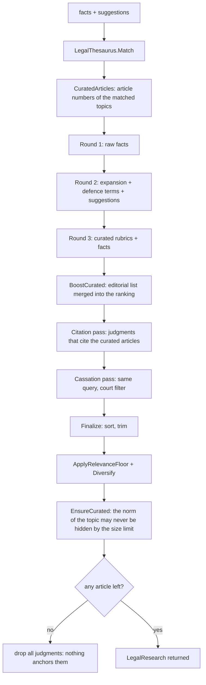

# Retrieval: engines, ranking and benchmark

This is the part of the tool that decides **which norms and which judgments are relevant to a
case**. It is deterministic by design: no LLM ranks anything. The same facts always produce the
same article set, which is what makes the output auditable.

- [1. The problem](#1-the-problem)
- [2. Candidate engines and the benchmark verdict](#2-candidate-engines-and-the-benchmark-verdict)
- [3. Text normalisation](#3-text-normalisation)
- [4. The research loop](#4-the-research-loop)
- [5. Scoring](#5-scoring)
- [6. Gates: relevance floor and court mix](#6-gates-relevance-floor-and-court-mix)
- [7. Choosing an engine at runtime](#7-choosing-an-engine-at-runtime)
- [8. Benchmark methodology](#8-benchmark-methodology)
- [9. Results](#9-results)
- [10. What was tried and rejected](#10-what-was-tried-and-rejected)
- [11. Tuning the retrieval](#11-tuning-the-retrieval)

---

## 1. The problem

Three properties of the corpus break a naive full-text search:

1. **Vocabulary mismatch.** A client writes "mi hanno preso l'auto dal parcheggio"; art. 624 says
   "chiunque si impossessa della cosa mobile altrui". Almost no shared words, yet they are the same
   thing. Term statistics cannot bridge that gap; a curated thesaurus can.
2. **The archive is skewed.** Of ~23,000 judgments, about 97% are Corte costituzionale decisions
   that quote the entire penal code. A BM25 ranking is therefore dominated by decisions that
   mention every article and interpret none.
3. **Rubrics are the answer.** For a criminal case the norm that matters is the one whose *rubric*
   names the case ("Furto", "Furto aggravato", "Ricettazione"). A hit in a two-word rubric is worth
   far more than a hit in a 4,000-word judgment body.

The retrieval layer answers each of these explicitly: thesaurus for (1), court weighting and
article affinity for (2), rubric-weighted BM25 for (3).

## 2. Candidate engines and the benchmark verdict

Three engines were implemented against the same normalised corpus and the same 35-query gold set.
All are open source, cross-platform and usable from .NET without a server.

| Candidate | Package | Why it was considered | Verdict |
|---|---|---|---|
| **SQLite FTS5** | `Microsoft.Data.Sqlite` (+ bundled `e_sqlite3`) | Embedded, zero configuration, BM25 built in, ships in the package, works on Windows/macOS/Linux | **Winner** |
| **Lucene.Net 4.8** with `ItalianAnalyzer` | `Lucene.Net.Analysis.Common` | Best-in-class IR library, real Italian analyser with stemming | Second |
| **Lucene.Net 4.8** with `StandardAnalyzer` | `Lucene.Net` | Control run: how much the Italian analyser is worth | Last |
| Vector / embedding search (ONNX MiniLM, `Microsoft.ML.OnnxRuntime`) | - | Would bridge the vocabulary gap semantically | Rejected: adds a ~90 MB model download, a tokenizer and non-deterministic scores; the curated thesaurus solves the same problem with auditable, verifiable output |
| `Azure AI Search` / any hosted index | - | Excellent relevance | Rejected: requires a service and a subscription, violates the "no external dependency" requirement |

The benchmark table is published in [../benchmark-results.md](../benchmark-results.md) and
summarised in [../README.md](../README.md) §3.2. The measured outcome:

* **FTS5 beats Lucene by a wide margin** on this corpus (MRR@10 0.663 vs 0.268 with the Italian
  analyser). The reason is not that Lucene is worse in general: it is that Lucene's `ItalianAnalyzer`
  applies aggressive stemming and elision, which collapses legal terms that must stay distinct
  ("furto" vs "furtivo", "appropriazione" vs "proprio"), while FTS5 here is fed an index whose text
  is already normalised by `ItalianText` with a deliberately light stemmer.
* **The hybrid layer on top of FTS5 is worth far more than the engine choice** (MRR@10 0.663 ->
  0.760). Choosing the right engine matters; layering legal knowledge on top matters more.
* Lucene is kept in the codebase as a selectable engine, because the benchmark must be
  reproducible and because a future corpus (much larger, multi-language) could change the verdict.

## 3. Text normalisation

Both sides of the match - the index and the query - go through the same function, so they can never
disagree:

```csharp
ItalianText.ToSearchText(text)  // fold -> tokenize -> drop stop words -> light stem -> join
```

* **Fold**: lowercase and replace accented characters, so "perché" and "perche" are the same term.
* **Tokenize**: letters, digits, `-` and `'` are kept inside a token; everything else splits. This
  preserves "3-bis", "art. 624" and "l'art. 2043".
* **Stop words**: a compact Italian list; numbers are always kept, because article numbers are
  numbers.
* **Light stem**: strips at most one suffix, longest first, and never below four characters. So
  "furto" and "furti" both become "furt", "appropriazione" becomes "appropri", while "pena" (four
  characters) is left untouched. The conservatism is deliberate: over-stemming merges concepts that
  must stay distinct (`pena`/`penale` is fine, `furto`/`furtivo` is not).
* `LegalLexicon` then removes stems that carry no discriminating power at all ("reat", "pen",
  "codic", "articol", "norm", ...), so the relevance floor in §6 measures case-specific overlap
  rather than "this document is about law".
* The same pipeline is applied to `heading`, `body` and `citation` before insert, so BM25 works on
  clean terms instead of raw punctuation.

`LegalLexicon.Distinctive(tokens)` is the other half of normalisation: it removes generic legal
vocabulary (`reat*`, `pen*`, `legg*`, `codic*`, `articol*`, `norm*`, `fatt*`, `cas*`, ...) so the
relevance floor in §6 measures *case-specific* overlap, not "this document is about law".

## 4. The research loop

`LegalRetriever.Research` is the deterministic loop the tool runs on every call. It performs a
fixed number of rounds - three for `LegalOpinion`, two for `GetLaws` - and never loops until
"enough": the bound is part of the contract, so latency is predictable.



Round construction:

| Round | Query | Weight | Purpose |
|---|---|---|---|
| 1 | the facts verbatim | 1.00 | The caller's own words are the strongest signal. |
| 2 | topic expansion + defence checklist terms + suggestions | 0.80 | Reach the language of the code from colloquial facts. |
| 3 | `art. <n> <rubric>` of the curated articles + facts | 0.65 | Reach the editorial vocabulary of the archive. |

Each round searches articles (`limit = 2 x maxArticles`) and judgments (`limit = 3 x maxJudgments`)
separately, because the two need different limits and different post-processing.

Then two dedicated judgment passes run when the topic produced curated articles:

* **Citation pass** - query built from `Art. 624 c.p.` style citations, `limit = max(80, 12 x n)`.
  The archive's schede list the articles they interpret, so an exact citation string is the
  sharpest key available. The wide limit exists because the Constitutional Court floods the top of
  a plain ranking.
* **Cassation pass** - the same query with `court = "Corte di cassazione"`, `limit = max(30, 4 x n)`.
  The Court of Cassation is the court whose interpretation a judge applies; without a dedicated
  pass it would never surface against 22,000 Constitutional Court decisions.

`LegalResearch` accumulates the best score per document (`AddArticles` / `AddJudgments` keep the
maximum), so a document found by several rounds is not counted twice and not diluted.

## 5. Scoring

Every batch of engine scores is rescaled before merging, so that scores coming from different
queries are comparable:

```csharp
score = rawScore / maxRawScore * 0.9      // LegalResearch.Normalize
```

The `0.9` ceiling is deliberate: it leaves room above every engine hit for the curated articles,
which occupy `0.40 .. 0.98`. A curated article can therefore never be outranked by pure term
statistics - which is the whole point of having an editorial list.

### 5.1 Curated articles

`BoostCurated(curated, question)` assigns each curated article a score:

| Situation | Score |
|---|---|
| Already found by the engine for these facts | `found + 0.24` |
| Missed by the engine | `max(0.40, 0.55 - 0.003 x index)` |
| Rubric is a multi-word phrase contained in the question ("furto aggravato") | `+ 0.20` |
| Rubric is one word and that word is in the question ("furto" -> art. 624) | `+ 0.12` |
| Ceiling | `min(0.98, score)` |

The `-0.003 x index` term preserves the editorial order of the topic list: within the "missed"
group, the first curated article is the most relevant by construction.

### 5.2 Judgments

Lexical similarity alone is not a usable signal for case law, so the judgment score is blended:

```csharp
score = 0.6 * normalizedScore + 1.2 * affinity * courtWeight
```

| Component | Definition | Range |
|---|---|---|
| `affinity` | `ArticleAffinity`: how many of the case's article numbers appear in the scheda as `art. N`, `art.N` or `articolo N`, divided by `min(3, articleCount)`, capped at 1 | 0..1 |
| `courtWeight` | `Corte di cassazione` 1.40, `Corte costituzionale` 1.00, other 0.95 | 0.95..1.40 |

Affinity carries twice the weight of the lexical score (`1.2` vs `0.6`) because a decision that
interprets the article of the case is relevant even when it shares few words with the facts, and
a decision that merely mentions the topic is not.

## 6. Gates: relevance floor and court mix

Two deterministic filters run after `Finalize`:

**`ApplyRelevanceFloor(anchors, minimum)`** drops documents that do not share enough *distinctive*
terms with the question. Without it, a nonsense topic still returns "relevant" articles, because
every article in the archive is about a reato or a contratto.

| Rule | Detail |
|---|---|
| Anchors | `LegalLexicon.Distinctive(Tokenize(facts + suggestions))`, capped at 24 |
| Article minimum | 2 anchors when there are >= 4 anchors, otherwise 1 |
| Curated articles | **never** dropped: they come from the editorial list, not from statistics |
| Judgment minimum | `clamp(ceil(anchors x 0.25), 2, 4)` - a massima states the principle abstractly, so it legitimately shares less vocabulary |
| Judgment exception | affinity > 0 (the scheda cites an article of the case) always passes |

**`Diversify(hits, maxJudgments)`** builds the case-law section with a court policy instead of a
pure ranking:

* half of the slots (at least one) are reserved for the Court of Cassation;
* then the remaining slots are filled with a per-court cap of `max(2, maxJudgments / 3)`;
* then any leftover slot is filled ignoring the cap, because a section one item short is worse than
  three decisions of the same court.

**`EnsureCurated(curated, maxArticles)`** is the last gate: it appends any citable curated article
the engine missed, up to the size limit, and logs
`Curated article Art. 624 c.p. kept in the answer (the engine missed it).` This is the recall
guarantee: the size limit may never hide the norm of the topic.

**Case law without a norm is dropped.** If no article survives, all judgments are discarded
(`No article anchors the question: N judgments dropped.`). Showing decisions alone would suggest a
relevance that does not exist.

## 7. Choosing an engine at runtime

```csharp
LegalSearchEngines.Resolve(engineId)   // null -> LEGALASSISTANTTOOL_ENGINE -> default
```

| Engine id | Implementation | Needs |
|---|---|---|
| `sqlite-fts5-bm25` (**default**) | `Fts5LegalSearchEngine` | `index/legal.db` (always built) |
| `lucene-italian` | `LuceneLegalSearchEngine` | Lucene index built with `LEGALASSISTANTTOOL_LUCENE=1` |
| `lucene-standard` | `LuceneStandardLegalSearchEngine` | Same |

An unknown id falls back to the default instead of throwing, so a typo in an environment variable
can never take the tool down.

## 8. Benchmark methodology

The benchmark project is `LegalAssistantTool.Benchmark`. It is deliberately small and readable so
that the numbers can be re-derived by anyone.

**Gold set** (`GoldSet.cs`): 35 queries - 20 criminal, 15 civil - each with the article numbers a
competent Italian lawyer would open for that fact pattern. Two rules keep it honest:

* The relevant articles are **hand-picked from the codes**, never taken from the thesaurus. Using
  the curated list as ground truth would reward the hybrid engine for its own prior.
* Numbers the archive does not contain are dropped by the runner and reported, so the set cannot
  drift away from the actual corpus.

**Metrics**:

| Metric | Definition | What it tells you |
|---|---|---|
| P@5 | share of the first five articles that are relevant | precision at the top, where a lawyer reads |
| R@10 | share of the relevant articles found in the first ten | recall - did we find all the norms of the case |
| MRR@10 | mean reciprocal rank of the first relevant article | how quickly the answer appears |
| Affinity@10 | share of the first ten judgments that cite a relevant article | whether the case law is anchored to the right norms |

**Running it**:

```powershell
cd C:\Users\andre\OneDrive\Sorgenti\LegalAssistantTool
dotnet run -c Release --project LegalAssistantTool.Benchmark -- ..\..\benchmark-results.md
# add "diag" as a second argument to print the per-query top hits
```

The runner builds the Lucene indexes on demand, then evaluates all three engines against the same
corpus and rewrites the Markdown report.

**Ablation recipe** for a ranking change:

1. Change one constant in `LegalRetriever` (e.g. `CuratedBonus`).
2. Re-run the benchmark and compare MRR@10 *and* P@5: a change that lifts MRR but lowers P@5 is
   usually over-fitting to one query.
3. If the change wins, also run the harness (`laws`, `opinion`, `verify`) to confirm that the
   rendered output still contains the right articles.
4. Record the outcome in §10 so the next person does not repeat the experiment.

## 9. Results

Corpus 4,251 articles / 23,049 judgments, 35 queries:

| Engine | P@5 | R@10 | MRR@10 | Affinity@10 | Latency |
|---|---|---|---|---|---|
| **Hybrid: curated topics + relevance floor + court mix (FTS5)** | **0.274** | **0.814** | **0.760** | **0.280** | 809.5 ms |
| SQLite FTS5 + BM25 (Italian fold+stem) | 0.217 | 0.576 | 0.663 | 0.237 | 197.0 ms |
| Lucene.Net 4.8 BM25 + ItalianAnalyzer | 0.097 | 0.281 | 0.268 | 0.073 | 18.3 ms |
| Lucene.Net 4.8 BM25 + StandardAnalyzer | 0.011 | 0.024 | 0.034 | 0.016 | 17.3 ms |

Reading the table: the hybrid layer buys **+15% MRR and +41% recall** over plain FTS5, at four
times the latency - still under one second per query, which is negligible next to the LLM calls in
`LegalOpinion`. P@5 of 0.274 means that, on average, one or two of the first five articles are on
the lawyer's list; the remaining slots are adjacent norms (aggravating circumstances, definitions,
procedural rules) which a legal answer legitimately needs.

## 10. What was tried and rejected

| Experiment | Result | Decision |
|---|---|---|
| Plain FTS5, no curated layer | MRR@10 0.663 | Baseline, kept as a selectable engine. |
| Pure hybrid without score normalisation | Curated articles outranked by BM25 term statistics | Fixed with the `0.9` rescale. |
| Curated articles without `EnsureCurated` | The article of the question was sometimes missing because it fell just below the size limit | Fixed: append-only guarantee. |
| `CuratedMissBase` 0.75 / floor 0.60 | Pushed curated articles above genuinely better lexical hits | Lowered to 0.55 / 0.40 (current values, measured better). |
| Court mix without the Cassation quota | Six Constitutional Court decisions in every answer | Fixed with the reserved quota. |
| Judgment score without affinity | Topically similar, normatively wrong case law | Fixed with `1.2 x affinity x courtWeight`. |
| Lucene with `ItalianAnalyzer` | MRR@10 0.268 | Rejected as the default; kept for benchmarking. |
| Embedding search | Would need a model download and non-deterministic scores | Rejected. |

## 11. Tuning the retrieval

| I want to... | Where |
|---|---|
| Add or fix a topic (triggers, curated articles, defence points) | `Legal/LegalThesaurus.cs` - see [DEVELOPER-GUIDE.md](DEVELOPER-GUIDE.md) |
| Change a ranking constant | `Legal/LegalRetriever.cs` lines 104-120 |
| Change the BM25 column weights | `LegalIndex.RankExpression` |
| Change the relevance floor | `LegalRetriever.Research` (anchor count) and `ApplyRelevanceFloor` |
| Change the court policy | `LegalRetriever.Diversify`, `CourtWeight` |
| Add an engine | Implement `ILegalSearchEngine`, register it in `LegalSearchEngines.Registry`, add it to the benchmark |
| Add a gold query | `LegalAssistantTool.Benchmark/GoldSet.cs` |

After any change: re-run the benchmark, then the harness (`laws`, `opinion`, `verify`), then
`dotnet pack`. The benchmark is the only defence against a well-meaning tweak that makes one
scenario better and the tool worse.